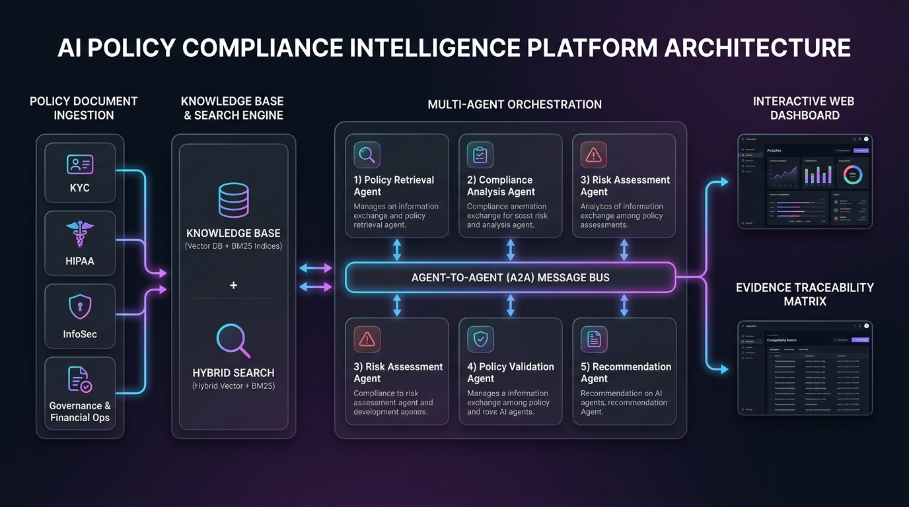

# 🛡️ Policy Compliance Intelligence Platform

[](https://www.python.org/)
[](https://fastapi.tiangolo.com/)
[](#architecture)
[](#evaluation)

An AI-powered **Policy Compliance Intelligence Microservice & Web Dashboard** that enables business users and compliance teams to submit natural language scenarios or operational activities and receive evidence-grounded compliance analysis, risk ratings, regulatory penalty evaluations, and actionable remediation recommendations.

---

## 🌟 Key Features & Tasks Completed

| Task | Task Overview | Implementation Details | Status |
| :--- | :--- | :--- | :---: |
| **Task 1** | **Policy Data Preparation & Knowledge Base** | Structured corpus of enterprise policies across 5 domains (KYC/AML, HIPAA, InfoSec, Governance, Treasury) indexed with full section & clause metadata. | ✅ **100%** |
| **Task 2** | **Policy Retrieval & Evidence Search** | Hybrid retrieval engine combining TF-IDF Vector Cosine Similarity + BM25 Okapi Keyword Search + Category & Metadata Filters. | ✅ **100%** |
| **Task 3** | **Multi-Agent Workflow & Risk Assessment** | 5 Specialized AI Agents (Retrieval, Analysis, Risk, Validation, Recommendation) with A2A communication bus, workflow handoffs, and evidence traceability matrix. | ✅ **100%** |
| **Task 4** | **Evaluation, Reporting & User Application** | Built-in evaluation harness (10 ground-truth benchmarks) + Modern Glassmorphic Web Dashboard with printable compliance audit report exporter. | ✅ **100%** |
| **Task 5** | **Architecture, Docs & Presentation** | Full technical architecture documentation, visual system diagram (`architecture_diagram.png`), executable microservice, and 10-min presentation slides. | ✅ **100%** |

---

## 📐 Architecture & Data Flow



```
[ Policy Documents Ingestion ] ➔ [ Hybrid KB Indexing (Vector + BM25) ]
                                            │
                                            ▼
[ User Scenario Query ] ➔ 🤖 Policy Retrieval Agent ➔ 📋 Compliance Analysis Agent
                                                                 │
                                                                 ▼
[ Printable Audit Report ] ◄ 🛡️ Policy Validation Agent ◄ ⚠️ Risk Assessment Agent
            ▲                                                    │
            │                                                    ▼
[ Interactive Dashboard ] ◄───────────────────────── ✅ Recommendation Agent
```

---

## 🚀 Quickstart & Installation Guide

### Prerequisites
* Python 3.10+
* Node.js v18+ (Optional, frontend served via FastAPI)

### 1. Install Dependencies
```bash
cd policy-compliance-intelligence
pip install -r requirements.txt
```

### 2. Launch Platform (Backend REST API + Frontend UI)
```bash
python run.py
```

* **Interactive Web Dashboard**: [http://localhost:8000](http://localhost:8000)
* **Swagger API Documentation**: [http://localhost:8000/docs](http://localhost:8000/docs)

### 3. Run Automated System Unit Tests
```bash
python tests/test_system.py
```

---

## 📊 Benchmark Evaluation Results (Task 4)

Evaluation conducted over **10 complex ground-truth compliance scenarios**:

* **Precision @ K**: `88.3%`
* **Recall @ K**: `95.0%`
* **Evidence Grounding Score**: `100.0%`
* **Status Classification Accuracy**: `90.0%`
* **Risk Classification Precision**: `90.0%`
* **Average Execution Latency**: `2.6 ms`

---

## 🔌 API Endpoint Reference

### 1. `POST /api/analyze-compliance`
Submits a compliance scenario for multi-agent evaluation.

**Sample Request**:
```json
{
  "scenario_text": "Onboarding a foreign politician (PEP) without an EDD report or MLRO sign-off.",
  "policy_category": "KYC / AML",
  "include_agent_trace": true
}
```

**Sample Response**:
```json
{
  "scenario_id": "SCN-A1B2C3D4",
  "overall_compliance_status": "Non-Compliant",
  "overall_risk_level": "Critical",
  "executive_summary": "Evaluated scenario against 2 relevant policy clause(s). Overall Status: Non-Compliant (Risk Level: Critical).",
  "retrieved_clauses": [
    {
      "clause": {
        "clause_id": "KYC-1.2",
        "policy_name": "Global Anti-Money Laundering & Know Your Customer (KYC) Policy",
        "section_number": "1.2",
        "section_title": "Enhanced Due Diligence (EDD) for Politically Exposed Persons (PEPs)"
      },
      "relevance_score": 1.0
    }
  ],
  "risk_assessment": [
    {
      "severity": "Critical",
      "risk_category": "Anti-Money Laundering (AML) Compliance Gap",
      "title": "Unverified PEP / High-Risk Account Exposure",
      "potential_penalty": "FinCEN / OCC enforcement actions, deferred prosecution agreements, multi-million dollar fines."
    }
  ],
  "remediation_actions": [
    {
      "priority": "Immediate",
      "title": "Execute Enhanced Due Diligence (EDD) & Obtain MLRO Sign-Off",
      "required_approvals": ["Money Laundering Reporting Officer (MLRO)"]
    }
  ],
  "execution_time_ms": 2.6
}
```

### 2. `POST /api/search`
Ground-truth policy evidence search.
```bash
POST /api/search?query=HIPAA+Business+Associate+Agreement+vendor
```

### 3. `GET /api/evaluate`
Triggers full benchmark evaluation harness.

---

## 📁 Repository Structure

```
policy-compliance-intelligence/
├── backend/
│   ├── main.py                   # FastAPI application & REST routing
│   ├── knowledge_base.py         # Hybrid Vector + BM25 search engine
│   ├── policy_corpus.py          # Structured policy documents dataset
│   ├── agent_workflow.py         # Multi-agent orchestrator & A2A bus
│   ├── evaluation.py             # Ground-truth benchmark evaluation harness
│   ├── models.py                 # Pydantic schemas & response models
│   └── agents/                   # 5 Specialized Agent implementations
│       ├── base_agent.py
│       ├── retrieval_agent.py
│       ├── analysis_agent.py
│       ├── risk_agent.py
│       ├── validation_agent.py
│       └── recommendation_agent.py
├── frontend/                     # Modern Glassmorphic SPA Dashboard
│   ├── index.html
│   ├── css/styles.css
│   └── js/app.js
├── docs/                         # Technical & Presentation Documentation
│   ├── architecture.md           # Deep architectural design & trade-offs
│   ├── architecture_diagram.png  # Generated high-resolution architecture diagram
│   └── presentation_slides.md   # 10-min panel presentation script & slides
├── tests/
│   └── test_system.py            # Automated integration & unit test suite
├── requirements.txt
├── run.py                        # Single-command application launcher
└── README.md
```
